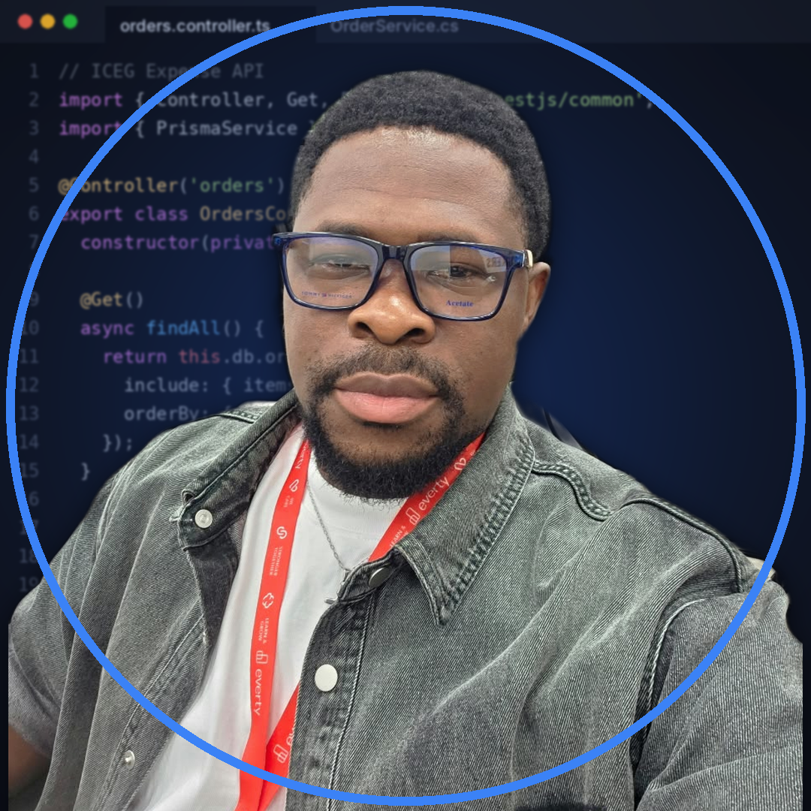

  

<h1 align="center">Hi, I'm Nnanna Echi 👋</h1>

  <b>Backend Developer @ First Bank of Nigeria</b> · Full Stack Developer 
  TypeScript · Node.js · NestJS · React / Next.js · C# / .NET

  
  
  
  
  
  

  
  

---

## 👨🏾‍💻 About Me

I'm a **Backend Developer at [First Bank of Nigeria](https://www.firstbanknigeria.com/)**, where I build and maintain backend services for banking systems that need to be reliable, secure and auditable.

Beyond my day job, I build **scalable, secure web applications** end to end, from well-structured REST APIs and relational data models to fast, accessible front-ends.

I work across two ecosystems:

- **JavaScript / TypeScript** — React, Next.js, Node.js, Express and NestJS, with Prisma ORM for type-safe data access.
- **C# / .NET** — ASP.NET Core Web APIs with Entity Framework Core and Dapper for high-performance SQL.

My background in **Petroleum Engineering** shaped how I work: analytical, detail-oriented, and focused on systems that hold up under real-world load.

**What I bring to a team**

- 🧱 Clean, layered architecture (controllers → services → data access) that's easy to test and extend
- 🔐 Security-first APIs — authentication, authorization, input validation
- ⚡ Performance-aware data access — knowing when to use an ORM and when to drop down to raw SQL
- 🤝 Clear communication, code reviews, and documentation that helps the next developer

 

---

## 🛠️ Tech Stack

**Languages**

  

**Front-end**

  

**Back-end & Data**

  
   
  
  

**Tools**

  

---

## 💼 Experience

### Backend Developer · [First Bank of Nigeria](https://www.firstbanknigeria.com/)

*Lagos, Nigeria · Present*

<!--
  TODO: Change these bullets to match your actual work, and add numbers where you can
  (e.g. "API serving 50k+ daily transactions", "cut report generation time by 40%").
  Do not include confidential or internal system details.
-->

- Build and maintain backend services and REST APIs that support core banking operations
- Design data access layers with a focus on performance, data integrity and security
- Work within the strict security, compliance and audit requirements of a regulated financial institution
- Work with cross-functional teams on code reviews, testing and production releases

---

## 🚀 Featured Projects

<!--
  TODO: Replace the rows below with your 3–4 strongest personal or open-source projects.
  Most bank work is proprietary, so public projects are how recruiters see your code.
  Recruiters look for: what it does, the stack, and a live demo or repo link.
-->

| Project | Description | Stack | Links |
| :-- | :-- | :-- | :-- |
| **Project One** | One-line summary of the problem it solves and the result. | `Next.js` `TypeScript` `Prisma` | [Live](#) · [Code](#) |
| **Project Two** | One-line summary of the problem it solves and the result. | `NestJS` `PostgreSQL` | [Live](#) · [Code](#) |
| **Project Three** | One-line summary of the problem it solves and the result. | `ASP.NET Core` `EF Core` `Dapper` | [Live](#) · [Code](#) |

---

## 📊 GitHub Activity

  
  

  

  
<b>📈 Contribution graph</b>

   
  

---

## 📫 Let's Work Together

I'm always happy to connect with engineers, recruiters and teams working on backend, fintech or full stack projects.
The fastest way to reach me is by [email](mailto:nnanna.echi018@uniport.edu.ng) or on [LinkedIn](https://linkedin.com/in/nnanna-echi-445b6249).

  <i>Thanks for stopping by — let's build something great.</i>

